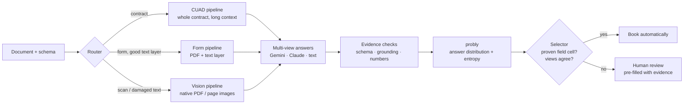

# Project 1: Teach a machine to say "I don't know"

**Team A-Team** · SIXT Hackathon 2026 · original task brief: [`docs/task_brief.md`](docs/task_brief.md)

> We do not build the extractor that answers most often.
> We build the one that **knows which of its answers it can prove**, books only those, and routes everything else to a human.

---

## 1. The problem in one table

Every field of a document (contract clause, form box, checkbox) gets a value and a confidence. A field is **booked** when its confidence is >= the declared threshold.

| Outcome | Cost |
|---|---|
| Field sent to a human | **1** |
| Booked and correct | 0 (saves the 1) |
| Booked and wrong / hallucinated | **100** |

One wrong booking wipes out 100 correct ones. Automation only pays above **99% precision** *on the booked fields*. Coverage is secondary.

What makes it hard (dev data, 540 docs, 22,115 fields):

- **70.6%** of the fields are contract clauses (CUAD) that must match the gold text with token-F1 >= 0.8.
- **57.6%** of all fields are empty. A model that fills them is punished.
- **~40%** of the form PDFs (ExtractBench) are scans with no text layer, and many others have a damaged OCR layer (`ine Harbour Water Utillties` instead of `Pine Harbour Water Utilities`).
- The model's own confidence is meaningless: at "1.00" it is still wrong in ~10% of cases.

---

## 2. Architecture & Approach

**Trust is earned per field type, not per model.** The pipeline has three parts:

1. **Different documents, different pipelines.** A contract, a clean digital form, and a crooked scan need different inputs and prompts (`pipeline/router.py`).
2. **Different eyes, not the same eyes twice.** Asking one model three times measures consistency, not correctness. We ask **different model families on different inputs** (e.g. Gemini on the PDF, Claude on the PDF, Gemini on the text layer). The **probly** UQ library turns their answers into a distribution and an entropy (`uncertainty/uq_probly.py`).
3. **A selector that has to be convinced.** A field is booked only if its *field cell* (document family x field) has a measured track record on dev with zero errors over several independent documents, **and** the views agree with evidence in the document (`uncertainty/decision.py`, `evaluation/train_selector.py`). Everything else goes to a human.



---

## 3. Repository Map

```text
Project_1/
├── 1_download.sh               Organiser script: downloads raw datasets into data/raw/
├── 2_prepare.py                Organiser script: builds data/unified/{dev,test_public}.jsonl
├── 3_baseline.py               Organiser script: simple frequency baseline
├── 4_extract_example.py        Organiser starter extractor (reference)
├── 4_extract.py                Main extractor CLI (offline / LLM / multi-view / probly UQ)
├── 5_score.py                  Official scorer (computes net saving, precision, coverage, JSON output)
├── test_score.py               Official scorer unit tests
├── run_hidden.sh               Official submission entrypoint (runs 4_extract.py with frozen decision)
├── setup.sh                    Organiser quick-setup script
├── selection.tsv               Document selection manifest used by 1_download.sh & 2_prepare.py
├── models.json                 Model capabilities probed by tools/probe_models.py
├── requirements.txt            Core Python 3.12 dependencies (incl. probly==0.9.1)
├── requirements-dashboard.txt  Extra dependencies for the Streamlit review dashboard
├── .env.example                Template for LLM_BASE_URL, LLM_API_KEY, LLM_MODEL
├── EDA.md                      Exploratory data analysis (generated by tools/make_eda.py)
├── SUBMISSION.md               Hackathon submission report
│
├── pipeline/                   Document router, text quality gate, prompts, HTTP transport + reply cache, chunk merge
├── uncertainty/                Schema check, grounding, evidence rules, probly UQ aggregation, decision & policy
├── evaluation/                 Frozen dev splits, batch runner, run registry, reports, ablation, threshold/selector tuning
├── tools/                      CLI utilities: compare_results, make_eda, analyse_fields, cuad_analysis, probe_models, cache tools
├── dashboard/                  Streamlit review & analytics dashboard
├── submission/                 Frozen decision.json, make_slides.py, slides.pdf
├── docs/                       Task brief, architecture, data/scoring guide, probly guide, CUAD & dashboard docs
├── tests/                      Unit and regression test suite
├── data/                       (git-ignored except data/splits/manifest.json) Raw & unified datasets + frozen splits
├── cache/                      (git-ignored) Cached LLM replies (cache/replies/<model>/<prompt_version>/) & rendered pages
└── results/                    Kept prediction/score files (base_*, llm_*, probly5_*), plots/, and runs/
```

---

## 4. Setup & Data Generation (`data/`)

The `data/` directory is git-ignored (except `data/splits/manifest.json`). Python **3.12** is required for `probly==0.9.1`.

Run all commands from inside `Project_1/`:

```bash
# 1. Create virtual environment and install dependencies
python3.12 -m venv .venv
.venv/bin/python -m pip install -r requirements.txt

# Optional: install dashboard dependencies
.venv/bin/python -m pip install -r requirements-dashboard.txt

# 2. Configure LLM credentials
cp .env.example .env
# Edit .env and set LLM_BASE_URL, LLM_API_KEY, LLM_MODEL
```

### Download & Build `data/unified/*.jsonl`

```bash
# Downloads ExtractBench + CUAD (~60 MB) into data/raw/
bash 1_download.sh --accept-licenses
# Optional flags: --only extractbench|cuad|invoicebenchmark|drew_ipp  --force

# Builds data/unified/dev.jsonl and data/unified/test_public.jsonl
.venv/bin/python 2_prepare.py
# Optional flags: --sources extractbench cuad [invoicebenchmark drew_ipp]
```

### Build Frozen Group-Disjoint Dev Splits (`data/splits/*.jsonl`)

Splits `data/unified/dev.jsonl` into `fit` (50%), `select` (25%), `audit` (25%), `audit2`, and `smoke` (12 docs) without splitting document groups across splits:

```bash
.venv/bin/python -m evaluation.splits --seed 13
# Optional flags: --data data/unified/dev.jsonl --out-dir data/splits --force
```

### Regenerate `EDA.md`

```bash
.venv/bin/python tools/make_eda.py
```

---

## 5. Generating Predictions in `results/` (`4_extract.py`)

`4_extract.py` is the main extractor CLI (thin wrapper around `pipeline/extractor.py`). It reads `.env` automatically and caches LLM replies in `cache/replies/` so repeated runs with the same prompt/model/temperature are free.

For a given `--out results/NAME.jsonl`, it writes:
- `results/NAME.jsonl` — final field predictions (`doc_id`, `fields` with `value` and `confidence`)
- `results/NAME.diagnostics.jsonl` — per-field routing, grounding, and UQ diagnostics
- `results/NAME.samples.jsonl` — raw per-sample observations for offline ablation (`evaluation.ablation`)
- `results/NAME.manifest.json` — run configuration, pipeline SHA-256, and doc counts

### All `4_extract.py` CLI Arguments

| Argument | Description |
|---|---|
| `--data PATH` | **(Required)** Input JSONL file (e.g. `data/unified/dev.jsonl`). Never reads `gold`. |
| `--out PATH` | Output predictions `.jsonl` path (defaults to `RUN_DIR/preds.jsonl` if `--run-dir` is set). |
| `--run-dir DIR` | Register a self-contained run folder (`results/runs/<run_id>/`) with preds, sidecars, gold copy, `score.json`, and an entry in `results/runs/index.jsonl`. |
| `--run-name NAME` | Display name for the run in the registry (defaults to the `--run-dir` folder name). |
| `--limit N` | Process only the first `N` documents (useful for smoke tests). |
| `--mode {auto,llm,offline}` | `llm`: fail loudly if credentials/API fail. `offline`: keyword rules only (no API calls). `auto` (default): LLM if configured, else offline. |
| `--workers N` | Parallel jobs per document (default: `1`). |
| `--samples K` | Number of samples `K` per field/view (default: `1`). |
| `--temperature T` | Sampling temperature for stochastic samples (default: `0.7`). |
| `--sampling {mixed,identical}` | `mixed` (default): sample 0 at `temp=0.0`, remaining `K-1` at `--temperature`. `identical`: all `K` samples at `--temperature`. |
| `--uq-method {k1_grounded,k_agreement_only,k_agreement_conf,k_entropy,selector}` | Decision rule for confidence & booking (`k1_grounded` for `K=1`; `k_entropy` / `k_agreement_*` for `K>1`; `selector` for proven field-cell whitelist). |
| `--eb-views VIEWS` | ExtractBench vision pipeline on native PDF instead of text layer (e.g. `pdf_gemini,pdf_claude`). |
| `--cuad-views VIEWS` | CUAD long-context pipeline: `A` (A-text only) or `full` (`A-text,B-text`). Off by default. |
| `--chunk-chars N` | Character window per text chunk (default: `45000`). |
| `--overlap-chars N` | Overlap between consecutive chunks (default: `3000`). |
| `--batch-size N` | Schema fields per LLM request (default: `10`). |
| `--aggregator {v2,multiview}` | Sample aggregation engine (default: `v2`). |
| `--on-error {fail,abstain}` | `fail` (default): exit 1 on failed jobs without writing affected docs. `abstain`: write `null` / `0.0` for affected fields. |
| `--abstain-all` | Write `null` / `0.0` for every field with zero API calls. |
| `--decision PATH` | Load frozen pipeline configuration from `submission/decision.json`. |
| `--resume` | Resume an existing run with an identical pipeline configuration. |
| `--cache-dir DIR` | Reply cache directory (default: `cache/`). |
| `--no-cache` | Bypass reading/writing the reply cache. |

### Common Extraction Commands

```bash
# 1. Non-AI baselines (no API calls)
.venv/bin/python 4_extract.py --data data/unified/test_public.jsonl --out results/base_never.jsonl --abstain-all
.venv/bin/python 4_extract.py --data data/unified/test_public.jsonl --out results/base_offline.jsonl --mode offline
.venv/bin/python 3_baseline.py --train data/unified/dev.jsonl --target data/unified/test_public.jsonl --out results/base_common.jsonl

# 2. Single-pass LLM baseline (K=1)
.venv/bin/python 4_extract.py \
  --data data/unified/dev.jsonl \
  --out results/llm_dev.jsonl \
  --mode llm --samples 1 --workers 4 --on-error abstain

.venv/bin/python 4_extract.py \
  --data data/unified/test_public.jsonl \
  --out results/llm_test_public.jsonl \
  --mode llm --samples 1 --workers 4 --on-error abstain

# 3. Multi-sample probly UQ run (e.g. probly5 with K=3, k_entropy)
.venv/bin/python 4_extract.py \
  --data data/unified/dev.jsonl \
  --out results/probly5_dev.jsonl \
  --mode llm --samples 3 --temperature 0.7 --sampling mixed \
  --uq-method k_entropy --workers 4 --on-error abstain

.venv/bin/python 4_extract.py \
  --data data/unified/test_public.jsonl \
  --out results/probly5_test_public.jsonl \
  --mode llm --samples 3 --temperature 0.7 --sampling mixed \
  --uq-method k_entropy --workers 4 --on-error abstain

# 4. Run using the frozen submission config (same as run_hidden.sh)
.venv/bin/python 4_extract.py \
  --data data/unified/test_public.jsonl \
  --out results/final_test_public.jsonl \
  --mode llm --on-error abstain --decision submission/decision.json
```

---

## 6. Scoring (`5_score.py`) & Generating `*_score.json`

`5_score.py` evaluates a prediction `.jsonl` file against a gold `.jsonl` file and optionally writes the full score breakdown (including threshold curve and error-cost metrics) to a `*_score.json` file.

> **Important:** `5_score.py` iterates over every document in `--gold` and treats missing documents as abstained (`null`). If you ran `4_extract.py --limit N` or on a subset, score against a matching gold subset (or use `tools/import_legacy_runs.py` / `evaluation.run_batch`, which automatically slices the matching gold subset).

### All `5_score.py` CLI Arguments

| Argument | Description |
|---|---|
| `--gold PATH` | **(Required)** Gold JSONL file (e.g. `data/unified/dev.jsonl`). |
| `--pred PATH` | **(Required)** Predictions JSONL file (e.g. `results/probly5_dev.jsonl`). |
| `--threshold T` | Declared confidence threshold (e.g. `0.99`). Used for the headline score. |
| `--target-precision P` | Target precision for coverage headline (default: `0.99`). |
| `--review-cost C` | Cost of human review per field (default: `1.0`). |
| `--error-cost E` | Cost of a wrong/hallucinated auto-booked field (default: `100.0`). |
| `--json PATH` | Write the full JSON score report to `PATH` (e.g. `results/probly5_dev_score.json`). |

### Examples

```bash
# Score dev and write JSON report
.venv/bin/python 5_score.py \
  --gold data/unified/dev.jsonl \
  --pred results/probly5_dev.jsonl \
  --threshold 0.99 \
  --json results/probly5_dev_score.json

# Score test_public and write JSON report
.venv/bin/python 5_score.py \
  --gold data/unified/test_public.jsonl \
  --pred results/probly5_test_public.jsonl \
  --threshold 0.99 \
  --json results/probly5_test_public_score.json

# Sensitivity check at 20x and 500x error cost
.venv/bin/python 5_score.py --gold data/unified/test_public.jsonl --pred results/probly5_test_public.jsonl --threshold 0.99 --error-cost 20
.venv/bin/python 5_score.py --gold data/unified/test_public.jsonl --pred results/probly5_test_public.jsonl --threshold 0.99 --error-cost 500
```

---

## 7. Run Registry & Creating Plots (`tools/compare_results.py`)

### Registering Loose `results/*.jsonl` Files (`tools/import_legacy_runs.py`)

`tools/compare_results.py` reads registered runs from `results/runs/index.jsonl`. If you created a loose prediction file like `results/my_run.jsonl` directly with `4_extract.py --out ...` (without `--run-dir`), register it first:

```bash
.venv/bin/python tools/import_legacy_runs.py [--threshold 0.99] [--force] [--dry-run]
```

What it does: scans top-level `results/*.jsonl` files, matches each to its gold split (`dev` or `test_public`), copies predictions and sidecars into `results/runs/<run_id>/`, scores them, and appends the summary row to `results/runs/index.jsonl`.

### Generating Comparison Tables & Plots (`tools/compare_results.py`)

```bash
.venv/bin/python tools/compare_results.py [--threshold 0.99]
```

*(If `--threshold` is omitted, it reads `threshold` from `submission/decision.json`, falling back to `0.95`.)*

What it does:
1. Reads all valid runs from `results/runs/index.jsonl` (newest run wins per `name`).
2. Aligns runs on the exact shared `doc_id` intersection of the newest `probly*` run for `test_public` and `dev`.
3. Scores every aligned method at `error_cost = 20`, `100`, and `500` using `5_score.py`, and prints Markdown comparison tables to stdout.
4. Generates 4 PNG plots in `results/plots/`:
   - `1_test_precision_coverage.png` — Precision vs. Coverage curves on `test_public`
   - `2_test_net_saving.png` — Net Saving % bar chart vs. manual review on `test_public`
   - `3_test_error_cost_sensitivity.png` — Net Saving % across 20x / 100x / 500x error costs
   - `4_dev_precision_coverage.png` — Precision vs. Coverage progression on `dev`

---

## 8. Analysis, Calibration & Utility Commands

### `tools/` Scripts

| Command | What it does |
|---|---|
| `.venv/bin/python tools/analyse_fields.py results/llm_dev.jsonl` | Per-field error analysis + leave-one-group-out (LOGO) whitelist simulation on `dev.jsonl` (no API calls). |
| `.venv/bin/python tools/cuad_analysis.py --gold data/unified/dev.jsonl --pred results/llm_dev.jsonl --out-md docs/cuad_analysis.md --out-json results/cuad_analysis.json` | Detailed CUAD contract error breakdown (paraphrase vs. subset vs. superset vs. other location). |
| `.venv/bin/python tools/probe_models.py --pdf data/raw/extractbench/docs/short/07021-2016-p0014.pdf --models vertex_ai/gemini-3.7-flash vertex_ai/claude-sonnet-5.5 --write` | Probes which input formats (`pdf_file`, `pdf_image_url`, `png`, `text`) each model accepts; writes `results/model_probe.json` and updates `models.json`. |
| `.venv/bin/python tools/tune_quality.py --data data/splits/fit.jsonl --write` | Offline tuning of the text-layer quality gate (`pipeline/router_config.json`). |
| `.venv/bin/python tools/cache_stats.py` | Shows cached reply counts and disk usage per model / prompt version (supports `--purge <model> --yes`). |
| `.venv/bin/python tools/migrate_cache.py --dry-run` | Migrates legacy flat cache files to `cache/replies/<model_slug>/<prompt_version>/`. |
| `.venv/bin/python tools/make_eda.py` | Regenerates `EDA.md` from `data/unified/dev.jsonl`. |

### `evaluation/` Modules

| Command | What it does |
|---|---|
| `.venv/bin/python -m evaluation.run_batch --split smoke --name smoke-baseline --mode llm` | Runs `4_extract.py --run-dir` on a frozen split (`fit`, `select`, `audit`, `audit2`, `smoke`) or `--random N --seed S`, builds `fields.jsonl`, and writes `report.md`/`report.json`. |
| `.venv/bin/python -m evaluation.report --run <RUN_ID_OR_DIR>` | Generates `report.md` and `report.json` (per-cell precision, LOGO whitelist grid, Wilson-95 upper bound, missed savings). |
| `.venv/bin/python -m evaluation.ablation --input <IN.jsonl> --samples <RUN.samples.jsonl> --manifest <RUN.manifest.json> --gold <GOLD.jsonl> --out-dir results/ablation_select` | Offline ablation across `k1_grounded`, `k_agreement_only`, `k_agreement_conf`, `k_entropy` with zero API calls. |
| `.venv/bin/python -m evaluation.train_selector --run <RUN_ID_OR_DIR> --evidence grounded_text --out submission/selector.json` | Trains the proven field-cell whitelist selector on `fit` and writes `submission/selector.json`. |
| `.venv/bin/python -m evaluation.select_threshold ...` | Freezes threshold / selector configuration on `select` and audits once on `audit`. |
| `.venv/bin/python -m evaluation.preflight --split smoke --mode llm` | Preflight check for credentials, data files, and split integrity. |
| `.venv/bin/python -m evaluation.validate --run <RUN_ID_OR_DIR>` | Validates run manifest, predictions, and schema contracts. |

---

## 9. Submission, Dashboard, Tests & Slides

| Task | Command |
|---|---|
| **Hidden test (official submission)** | `bash run_hidden.sh <input.jsonl> <output.jsonl>` |
| **Review & analytics dashboard** | `.venv/bin/streamlit run dashboard/app.py` (see [`docs/dashboard.md`](docs/dashboard.md)) |
| **Run unit & regression tests** | `.venv/bin/python -m unittest discover -s tests && .venv/bin/python test_score.py` |
| **Generate presentation slides** | `.venv/bin/python submission/make_slides.py` -> `submission/slides.pdf` |

---

## Credits

- Zhang, Lyjak, Stewart, Li, Suo (2026). *ExtractBench: A Benchmark for Schema-Guided Enterprise Document Extraction.* arXiv:2607.29677.
- Hendrycks, Burns, Chen, Ball (2021). *CUAD: An Expert-Annotated NLP Dataset for Legal Contract Review.* NeurIPS Datasets and Benchmarks.
- **probly**: uncertainty quantification library (university).
