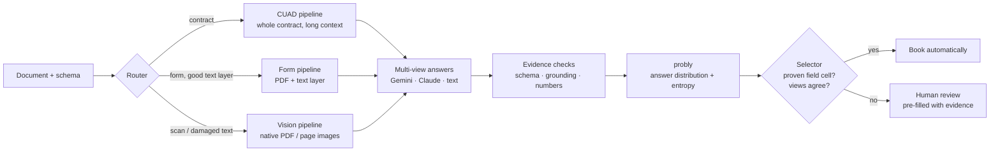

# Project 1: Teach a machine to say "I don't know"

**Team A-Team** · SIXT Hackathon 2026 · original task brief: [`docs/task_brief.md`](docs/task_brief.md)

> We do not build the extractor that answers most often.
> We build the one that **knows which of its answers it can prove**, books only those, and routes everything else to a human.

---

## 1. The problem in one table

Every field of a document (contract clause, form box, checkbox) gets a value and a confidence. A field is **booked** when its confidence is ≥ the declared threshold.

| Outcome | Cost |
|---|---|
| Field sent to a human | **1** |
| Booked and correct | 0 (saves the 1) |
| Booked and wrong / hallucinated | **100** |

One wrong booking wipes out 100 correct ones. Automation only pays above **99 % precision** *on the booked fields*. Coverage is secondary.

What makes it hard (dev data, 540 docs, 22,115 fields):

- **70.6 %** of the fields are contract clauses (CUAD) that must match the gold text with token-F1 ≥ 0.8.
- **57.6 %** of all fields are empty. A model that fills them is punished.
- **~40 %** of the form PDFs (ExtractBench) are scans with no text layer, and many others have a damaged OCR layer (`ine Harbour Water Utillties` instead of `Pine Harbour Water Utilities`).
- The model's own confidence is meaningless: at "1.00" it is still wrong in ~10 % of cases.

## 2. Our idea

**Trust is earned per field type, not per model.** The new approach has three parts.

1. **Different documents, different pipelines.** A contract, a clean digital form and a crooked scan need different inputs and prompts.
2. **Different eyes, not the same eyes twice.** Asking one model three times measures consistency, not correctness. It repeats its own mistake. We ask **different model families on different inputs** (Gemini on the PDF, Claude on the PDF, Gemini on the text layer). The university UQ library **probly** turns their answers into a distribution and an entropy.
3. **A selector that has to be convinced.** A field is booked only if its *field cell* (document family × field) has a measured track record on dev, with zero errors over several independent documents, **and** the views agree with evidence in the document. Everything else goes to a human. No exceptions for "high confidence".



### The pipelines

| Route | When | Inputs / views | Status |
|---|---|---|---|
| `cuad` | contracts | full contract text in one long-context call (no truncation); view A Gemini, view B Claude; spans checked word for word against the contract | planned (T07) |
| `pdf_text_good` | form with a clean text layer | native PDF (Gemini, Claude) + text layer (Gemini) | planned (T06) |
| `pdf_text_damaged` | text layer fails the quality gate | native PDF only (text layer is not trusted) | planned (T05/T06) |
| `pdf_no_text` | scan, no text layer | native PDF, or rendered page images for models without PDF input | planned (T06) |
| `legacy_text` | current code | text layer → chunked prompts → grounding → probly → decision | **implemented** |

Proven so far: `gemini-3.7-flash` reads PDFs natively, and `claude-sonnet-5.5` does too (via the `file` part). On the damaged K-1 scan both read `Pine Harbour Water Utilities LLC` correctly, where the text layer had it mangled.

### Why it can work: first evidence

We re-analysed our **stored** answers from earlier runs (307 dev docs, no new API calls), using the "only proven field cells" rule with leave-one-document-group-out:

| Rule | Booked | Wrong | Net saving |
|---|---:|---:|---:|
| Book on model confidence ≥ 0.99 | 976 | 78 | **−30.9 %** |
| **Whitelist of proven field cells + grounded value** | **378** | **0** | **+3.0 %** |

This is the first configuration in our project that beats the human baseline, and it uses only the weakest pipeline (text only). The vision and multi-view pipelines are expected to add more coverage.

## 3. Repository map

```
4_extract.py            extractor CLI (offline / LLM / all-abstain, frozen decision file)
pipeline/               job planning, prompts, HTTP transport + reply cache, chunk merge
uncertainty/            schema check, grounding, policy, probly aggregation, decision rules
evaluation/             partitions, threshold freeze/audit, ablation, validation
analyse_fields.py       per-field error analysis + whitelist simulation (offline)
vision_probe.py         checks which endpoint models accept PDF / image input
5_score.py              official scorer (unchanged)
submission/             decision.json, make_slides.py, slides.pdf
results/                stored predictions and score files
docs/                   task brief, data/scoring guide, probly guide
.kilo/plans/ (repo root) master plan + 14 sub-plans for the new architecture
```

The organiser files `1_download.sh`, `2_prepare.py`, `3_baseline.py`, `4_extract_example.py`, `5_score.py` and `test_score.py` are unchanged.

## 4. How to run

Python 3.12 (needed by `probly==0.9.1`). From `Project_1/`:

```bash
python3.12 -m venv .venv && .venv/bin/python -m pip install -r requirements.txt
bash 1_download.sh --accept-licenses && .venv/bin/python 2_prepare.py     # data/ (not committed)
cp .env.example .env                                                       # LLM_BASE_URL, LLM_API_KEY, LLM_MODEL
```

| Task | Command |
|---|---|
| Hidden test (submitted config) | `bash run_hidden.sh <input.jsonl> <output.jsonl>` |
| LLM run on a file | `.venv/bin/python 4_extract.py --data data/unified/dev.jsonl --out results/x.jsonl --mode llm --on-error abstain` |
| Same, through the shell wrapper (loads `.env`) | `bash run_cached.sh --data ... --out ... --mode llm` |
| Score | `.venv/bin/python 5_score.py --gold data/unified/dev.jsonl --pred results/x.jsonl --threshold 0.99` |
| Field analysis + whitelist simulation | `.venv/bin/python analyse_fields.py results/x.jsonl` |
| Which models read PDFs | `.venv/bin/python vision_probe.py <file.pdf> [model]` |
| Tests | `.venv/bin/python -m unittest discover -s tests && .venv/bin/python test_score.py` |
| Slides | `.venv/bin/python submission/make_slides.py` |

Replies are cached in `cache/` (currently all `gemini-3.7-flash`), so repeated runs are free. Score a subset only against a gold file with the same doc_ids: the scorer counts missing docs as abstained.

## 5. Roadmap

The full plan is in `.kilo/plans/1794596173299-master-plan.md` (14 sub-plans).

| Milestone | What | Gate |
|---|---|---|
| **M1** | reproducible run + field-cell selector on the current pipeline | audit net > 0 with ≥ 300 booked fields |
| **M2** | router, text-quality gate, vision + 2-model views for forms | more booked, no more errors |
| **M3** | long-context contract pipeline, selected clause types | same |
| **M4** | review dashboard (PDF · value · gold · confidence · accept/decline), docs, slides | – |

## Credits

- Zhang, Lyjak, Stewart, Li, Suo (2026). *ExtractBench: A Benchmark for Schema-Guided Enterprise Document Extraction.* arXiv:2607.29677.
- Hendrycks, Burns, Chen, Ball (2021). *CUAD: An Expert-Annotated NLP Dataset for Legal Contract Review.* NeurIPS Datasets and Benchmarks.
- probly: uncertainty quantification library (university).
