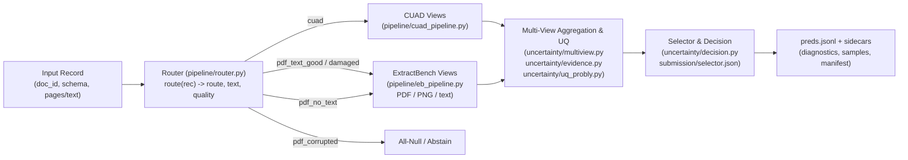

# Project 1 Architecture

High-level architecture for selective structured document extraction under asymmetric error cost (`review_cost = 1`, `error_cost = 100`).

## 1. End-to-End Pipeline

1. **Route (`pipeline/router.py`, `pipeline/text_quality.py`):** Assigns every record to one of `cuad`, `pdf_text_good`, `pdf_text_damaged`, `pdf_no_text`, or `pdf_corrupted` without reading `gold`.
2. **Views (`pipeline/eb_pipeline.py`, `pipeline/cuad_pipeline.py`, `pipeline/transport.py`):** Produces per-field observations across one or more model/input views (e.g., native PDF, rendered PNG, extracted text) backed by the model-scoped `ReplyCache`.
3. **Aggregation & Evidence (`uncertainty/multiview.py`, `uncertainty/single_view.py`, `uncertainty/evidence.py`, `uncertainty/uq_probly.py`):** Clusters candidate values using `5_score.py` matching semantics, computes `probly` entropy/agreement/credal features, and checks type-aware evidence grounding (`grounded_text`, `grounded_ocr`).
4. **Selector & Decision (`uncertainty/decision.py`, `evaluation/train_selector.py`, `evaluation/select_threshold.py`):** Applies `submission/selector.json` (or baseline UQ methods) to emit a calibrated confidence in `[0, 1]` for eligible fields and `null` / `0.0` otherwise.

## 2. Module Map

| Area | Path | Purpose |
| --- | --- | --- |
| CLI & Hidden Entry | `4_extract.py`, `run_hidden.sh` | Thin CLI wrapper (`main`) and hidden-test entrypoint; re-exports `pipeline.extractor` API. |
| Core Extractor | `pipeline/extractor.py` | `extract_document`, `run_jobs`, `run_file`, `Config`, `Ctx`, `load_decision`, `load_config`. |
| Routing & Quality | `pipeline/router.py`, `pipeline/text_quality.py`, `pipeline/router_config.json` | Document routing (`route(rec)`), PDF/CUAD text readers, text-layer quality score. |
| Domain Pipelines | `pipeline/eb_pipeline.py`, `pipeline/cuad_pipeline.py`, `pipeline/prompts_eb.py`, `pipeline/render.py`, `pipeline/merge.py` | ExtractBench vision/text extraction, CUAD chunked extraction, PDF rendering, chunk merging. |
| Model Transport & Cache | `pipeline/transport.py`, `pipeline/models.py`, `models.json`, `pipeline/requests.py`, `pipeline/messages.py` | `call_model`, `ReplyCache`, rate-limit/retry handling, model capability registry. |
| Uncertainty & Evidence | `uncertainty/contracts.py`, `uncertainty/evidence.py`, `uncertainty/grounding.py`, `uncertainty/schema_check.py`, `uncertainty/policy.py` | Contract v2 checks, type-aware grounding, schema validation, single-view policy. |
| Aggregation & Decision | `uncertainty/single_view.py`, `uncertainty/multiview.py`, `uncertainty/uq_probly.py`, `uncertainty/decision.py` | Single/multi-view clustering, `probly` entropy/credal metrics, `make_prediction` (`selector`, `k_entropy`, etc.). |
| Evaluation & Calibration | `evaluation/registry.py`, `evaluation/splits.py`, `evaluation/run_batch.py`, `evaluation/field_table.py`, `evaluation/report.py`, `evaluation/train_selector.py`, `evaluation/select_threshold.py` | Run folders & `index.jsonl`, frozen group splits, batch runner, field table, selector training, threshold selection. |
| Tools | `tools/analyse_fields.py`, `tools/cuad_analysis.py`, `tools/probe_models.py`, `tools/cache_stats.py`, `tools/tune_quality.py`, `tools/import_legacy_runs.py`, `tools/migrate_cache.py` | Offline error analysis, model probing, cache inspection/migration, legacy run import. |
| Dashboard | `dashboard/app.py`, `dashboard/data.py`, `dashboard/runner.py`, `dashboard/views/`, `dashboard/components/` | Streamlit run/review/analytics UI (optional; `requirements-dashboard.txt`). |
| Organiser Scripts (Unchanged) | `1_download.sh`, `2_prepare.py`, `3_baseline.py`, `4_extract_example.py`, `5_score.py`, `test_score.py` | Data download, unified dataset preparation, baselines, official scorer & tests. |

## 3. Data Contracts

| Contract | Owner | Implementation | Spec |
| --- | --- | --- | --- |
| Model-scoped `ReplyCache` | T01 | `pipeline/transport.py` (`ReplyCache(root, model, prompt_version, input_kind)`) | [t01-cache-restructure](../Plans/1794596173299-t01-cache-restructure.md) |
| Run Registry & `index.jsonl` | T02 | `evaluation/registry.py` (`results/runs/<run_id>/` + `results/runs/index.jsonl`) | [t02-run-registry](../Plans/1794596173299-t02-run-registry.md) |
| Frozen Splits & `fields.jsonl` | T03 | `evaluation/splits.py`, `evaluation/field_table.py` (`data/splits/manifest.json`) | [t03-evaluation-harness](../Plans/1794596173299-t03-evaluation-harness.md) |
| Multi-view Feature Dict | T09 | `uncertainty/multiview.py`, `uncertainty/uq_probly.py` | [t09-multiview-probly](../Plans/1794596173299-t09-multiview-probly.md) |
| `selector.json` Schema | T10 | `evaluation/train_selector.py`, `uncertainty/decision.py` (`submission/selector.json`) | [t10-selector-calibration](../Plans/1794596173299-t10-selector-calibration.md) |
| Extractor & `decision.json` v2 | T11 | `pipeline/extractor.py` (`extract_document(rec, config)`), `submission/decision.json` | [t11-extract-integration](../Plans/1794596173299-t11-extract-integration.md) |
